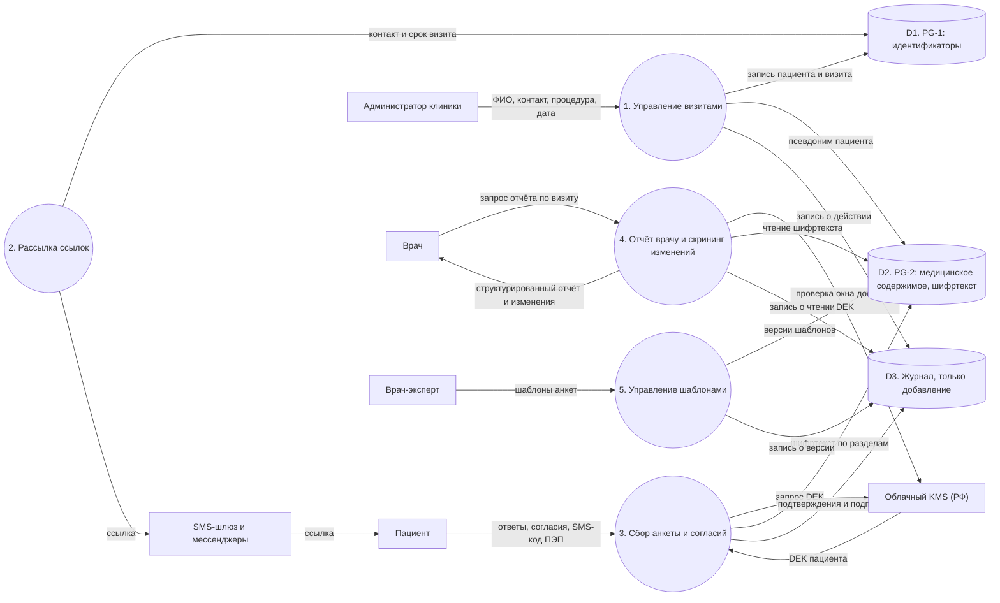
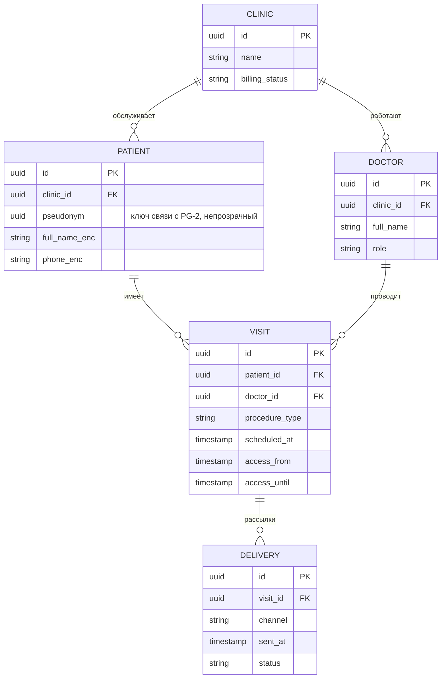
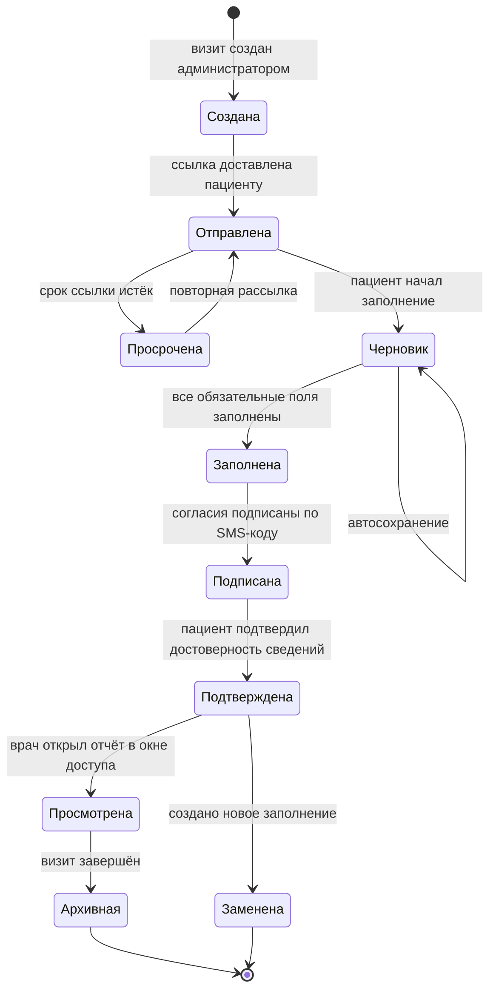
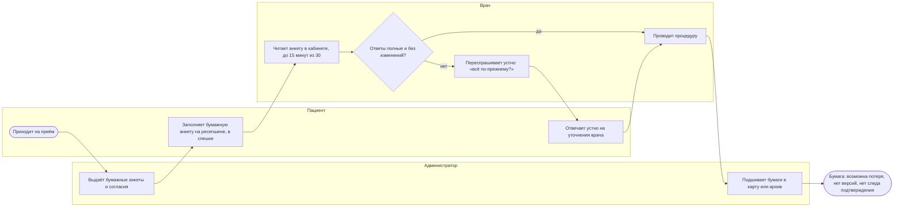
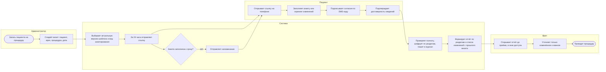

# ЛР 3 — проектирование

**Тема ВКР:** Разработка информационной системы дистанционного сбора и структурирования медицинского анамнеза пациентов косметологических клиник

**Автор или участники команды:**

1. Персук Виктория Петровна, К3440
2. Кисель Софья Михайловна, К3440
3. Пирогова Софья Андреевна, практикующий врач, сооснователь

**Вклад каждого участника при командной работе:**

1. Персук Виктория Петровна — архитектура, модели процессов;
2. Кисель Софья Михайловна — требования, модели данных;
3. Пирогова Софья Андреевна — содержание анкет, листа противопоказаний и клинические сценарии, проверка AS-IS по практике приёма.

---

## 1. Предметная область и требования

### Описание предметной области

Косметологическая клиника или частный кабинет перед инъекционной или аппаратной процедурой обязана собрать анамнез пациента, получить информированное добровольное согласие (ИДС) и согласие на обработку персональных данных, а при повторных визитах убедиться, что сведения не изменились. Сейчас это делается на бумаге или устно непосредственно перед процедурой: по оценке команды (кастдев, 10 интервью), на опрос при 30-минутном приёме уходит до половины времени, бумажные анкеты теряются, а у клиники нет следа того, что именно пациент подтвердил.

**Система** — платформа предварительного сбора, структурирования и хранения анамнестических анкет и согласий пациента. Она не интерпретирует ответы автоматически и не является медицинским изделием: все выводы делает врач.

**Пользователи:**
- *пациент* — получает персональную ссылку, заполняет анкету, подписывает согласия;
- *администратор клиники* — заводит визит и пациента, отслеживает статус;
- *врач* — получает структурированный отчёт до приёма, подтверждает ознакомление;
- *врач-эксперт / владелец клиники* — ведёт шаблоны анкет и листов противопоказаний;
- *технический администратор SONDER* — сопровождает платформу, не имеет доступа к медицинскому содержимому.

**Поддерживаемые процессы:** создание визита; рассылка ссылки за сутки до приёма; заполнение анкеты или скрининг изменений; подписание согласий (ПЭП по SMS); подтверждение достоверности сведений; просмотр отчёта врачом; журналирование; повторное анкетирование по расписанию.

**Нормативная рамка:** 152-ФЗ (ст. 6 ч. 3 — обработка по поручению оператора-клиники; ст. 10; ст. 18 ч. 5 — локализация), ПП РФ № 1119 (уровни защищённости), 323-ФЗ (ст. 20 — ИДС), 63-ФЗ (электронная подпись), ПП РФ № 659 (с 01.09.2026), приказ Минздрава № 381н, письмо Росздравнадзора № 02И-297/20.

### Функциональные требования

| ID | Требование | Как проверить выполнение |
|---|---|---|
| FR-01 | Врач-эксперт создаёт и редактирует шаблоны анкет по видам процедур; каждое изменение создаёт новую версию шаблона, ранее заполненные анкеты остаются привязанными к своей версии | Изменить шаблон; убедиться, что старое заполнение открывается в прежней редакции, а новое использует новую |
| FR-02 | Администратор создаёт пациента и визит (клиника, врач, дата, вид процедуры); система формирует персональную ссылку с ограниченным сроком действия | Создать визит; проверить уникальную ссылку и её недействительность после срока |
| FR-03 | Система отправляет ссылку по выбранному каналу (SMS, мессенджер, email) за заданное время до приёма (по умолчанию 24 ч) и повторяет напоминание, если анкета не заполнена | Тест с подменой времени: отправка в нужный момент, напоминание, запись в журнале доставки |
| FR-04 | Пациент заполняет анкету с телефона без установки приложения: ветвление вопросов, обязательные поля, контроль полноты формы, автосохранение черновика | Сквозной тест на мобильном браузере; обрыв сессии и возврат по ссылке сохраняют ответы |
| FR-05 | Система поддерживает три раздельных согласия (на обработку специальных категорий ПДн, ИДС на конкретную процедуру, дополнительные — например, на съёмку); подписание — простой электронной подписью по SMS-коду | Каждое согласие хранится отдельным документом со своей отметкой подписи; отзыв одного не затрагивает остальные |
| FR-06 | Пациент подтверждает достоверность сведений (лист противопоказаний по процедуре); подтверждение фиксируется с датой, редакцией шаблона и подписью | Без подтверждения анкета не переходит в статус «подтверждена»; запись содержит дату, версию, подпись |
| FR-07 | Врач получает до приёма структурированный отчёт по разделам анкеты; система не выдаёт автоматических выводов, оценок и рекомендаций | Сверка отчёта с ответами; проверка отсутствия вычисляемых выводов и запрещённых формулировок в интерфейсе (см. NFR-08) |
| FR-08 | При повторном визите система показывает врачу изменения относительно предыдущего подтверждённого заполнения (скрининг изменений) без оценки значимости | Два заполнения с разными ответами: отчёт показывает ровно изменённые поля |
| FR-09 | Система определяет вид анкетирования: короткий скрининг изменений перед каждой процедурой; полное переанкетирование через 6–12 месяцев, при смене типа процедуры и при перерыве более года | Тестовые визиты с разными датами и процедурами выбирают верный режим |
| FR-10 | Версионированный неизменяемый журнал: кто, когда, какое действие выполнил, какую редакцию шаблона и документа видел и подтвердил | Попытка изменить или удалить запись журнала отклоняется; для каждого подтверждения есть запись |
| FR-11 | Ролевой доступ: врач видит только пациентов своей клиники и только в окне доступа визита; администратор не видит медицинское содержимое; сотрудники SONDER не видят его вообще | Матрица ролей × операций; негативные тесты на чужую клинику и вне окна доступа |
| FR-12 | Клиника и пациент могут получить копию подписанных документов (анкета, согласия, лист противопоказаний) в PDF с отметками подписи | Выгрузка PDF; сверка содержимого и подписи с записью в БД |

### Нефункциональные требования

| ID | Требование | Как проверить выполнение |
|---|---|---|
| NFR-01 | **Защита данных в хранилище:** конвертное шифрование, отдельный ключ шифрования данных (DEK) на пациента, обёрнутый ключом облачного KMS в РФ; AES-GCM на каждый раздел анкеты; TLS не ниже 1.2 при передаче | Дамп БД содержит только шифртекст; DEK не хранится в открытом виде; проверка конфигурации TLS |
| NFR-02 | **Разделение контуров:** две физически раздельные БД — PG-1 (идентификаторы) и PG-2 (медицинское содержимое); связь только через непрозрачный псевдоним, без внешних ключей и общих учётных записей | Проверка сетевых правил и прав; ни одна учётная запись не имеет доступа к обеим БД |
| NFR-03 | **Локализация:** все ПДн хранятся и обрабатываются на серверах в РФ (ст. 18 ч. 5 152-ФЗ) | Реестр ресурсов с указанием региона; отсутствие зарубежных сервисов в потоке ПДн |
| NFR-04 | **Уровень защищённости:** меры по ПП № 1119 в объёме УЗ-3 при обосновании третьего типа угроз (модель угроз — отдельный документ) | Чек-лист мер; оценка эффективности раз в 3 года |
| NFR-05 | **Аудируемость:** журнал только на добавление; 100% операций чтения медицинского содержимого и подтверждений попадают в журнал; срок хранения — по политике клиники | Выборка операций и сверка с журналом |
| NFR-06 | **Удобство для пациента:** заполнение за 10–15 минут, mobile-first; целевая завершаемость анкет не ниже 85% (ориентир — 92,7% в [1]) | Метрики пилота: доля завершённых анкет, медианное время заполнения |
| NFR-07 | **Надёжность:** целевая доступность 99,5% в месяц; ежесуточные зашифрованные резервные копии; восстановление из копии проверяется | Мониторинг доступности; учебное восстановление |
| NFR-08 | **Соответствие позиционированию:** в интерфейсе, документации и тексте шаблонов нет формулировок, подразумевающих автоматическую интерпретацию или клинические выводы; проверка линтером словаря запрещённых формулировок в CI | Сборка падает при появлении запрещённого слова; ручной просмотр интерфейса |
| NFR-09 | **Сопровождаемость:** модульный монолит, контракт OpenAPI 3.1 (contract-first), монорепозиторий с path-based CI; покрытие критических модулей автотестами | Генерация клиента из спецификации; прогон CI по изменённым путям |
| NFR-10 | **Производительность:** p95 отклика страницы анкеты не более 2 с при целевой нагрузке пилота | Нагрузочный тест k6 |

---

## 2. Обзор нотаций и видов диаграмм

| Нотация или вид диаграммы | Что описывает | Сильные стороны |
|---|---|---|
| BPMN 2.0 (OMG; ISO/IEC 19510:2013) | Бизнес-процессы: события, задачи, шлюзы, пулы и дорожки | Отраслевой стандарт; наглядно показывает роли и передачу между ними; удобна для AS-IS/TO-BE |
| IDEF0 (Р 50.1.028-2001) | Функции с входом, управлением, выходом и механизмом; иерархическая декомпозиция | Строгая иерархия; нормативные требования отображаются как «управление» |
| IDEF3 | Последовательность и логика выполнения работ | Причинно-следственные связи, ветвления и синхронизация |
| DFD (Йордон — Де Марко, Гейн — Сарсон) | Потоки данных между процессами, хранилищами и внешними сущностями | Показывает границы контуров данных; основа моделирования угроз |
| ER-модель (Чен, 1976; «воронья лапка») | Сущности, атрибуты, связи, кардинальность | Чен — концептуальный уровень; «воронья лапка» близка к схеме СУБД |
| UML: диаграмма вариантов использования | Акторы и сценарии использования | Фиксирует границы системы и роли |
| UML: диаграмма классов | Структура классов и связи | Структура кода и предметной модели |
| UML: диаграмма последовательностей | Обмен сообщениями во времени | Интеграции, порядок вызовов, проверка сценариев |
| UML: диаграмма состояний | Жизненный цикл объекта и допустимые переходы | Исключает недопустимые переходы (например, анкета без подтверждения) |
| UML: диаграммы компонентов и развёртывания | Модули и их размещение на инфраструктуре | Связь программной архитектуры и серверов, зон безопасности |
| C4 model (S. Brown) | Контекст, контейнеры, компоненты, код | Масштабируемая детализация; подходит для модульного монолита и двух БД |
| EPC (ARIS, Scheer) | Цепочки «событие — функция» | Привычна в практике ARIS, строгое чередование событий и функций |
| DMN (OMG) | Таблицы решений и бизнес-правила | Прозрачные правила маршрутизации (например, выбор вида анкетирования) |
| ArchiMate 3.2 (The Open Group) | Бизнес-, прикладной и технологический слои архитектуры | Связывает процессы клиники, приложения и инфраструктуру (KMS, облако РФ) |
| ГОСТ 19.701-90 | Схемы алгоритмов, программ, данных и систем | Требуется для оформления части документов |

---

## 3. Выбор нотаций для проекта

**Логика выбора.** Бизнес-логику (кто, когда и что делает, где ветвления) лучше всего отражает BPMN. Потоки данных и границы контуров безопасности — DFD. Структуру данных и модель БД — ER-диаграмма в нотации «воронья лапка». Жизненный цикл анкеты и допустимые переходы — диаграмма состояний UML. Эти четыре нотации не дублируют друг друга: процесс (BPMN) → поток данных (DFD) → хранение (ER) → поведение объекта (UML state).

| Нотация или вид диаграммы | Что моделируем | Связанные требования | Почему подходит |
|---|---|---|---|
| BPMN 2.0 | Процесс «от создания визита до приёма» в двух состояниях — AS-IS и TO-BE | FR-02, FR-03, FR-04, FR-05, FR-06, FR-07, FR-09, NFR-06 | Показывает роли (администратор, система, пациент, врач) и передачи между ними; позволяет проверить, что каждый шаг требований присутствует и измерим |
| DFD уровня 1 | Потоки данных между внешними сущностями, процессами и двумя хранилищами; границы контуров | FR-05, FR-07, FR-10, FR-11, NFR-01, NFR-02, NFR-03, NFR-05 | Видно, какой поток содержит идентификаторы, а какой — медицинские данные, где применяется шифрование и где пишется журнал |
| ER-диаграмма («воронья лапка») | Модель данных обоих контуров: шаблоны и версии, заполнения, согласия, журнал, ключи | FR-01, FR-05, FR-06, FR-08, FR-10, NFR-01, NFR-02 | Проверяется версионирование, раздельные согласия и отсутствие связей между контурами, кроме псевдонима |
| UML: диаграмма состояний | Жизненный цикл анкеты | FR-04, FR-06, FR-08, FR-09, FR-10, FR-11 | Задаёт допустимые переходы; подтверждает, что без подписи и подтверждения достоверности анкета не попадёт врачу как подтверждённая |

---

## 4. Модели системы

### 4.1. Потоки данных и границы контуров (DFD, уровень 1)

**Диаграмма:**

**Пояснение модели:** пять процессов, три хранилища и три внешних сервиса. Идентификаторы (ФИО, контакты) лежат только в D1, медицинское содержимое — только в D2 в виде шифртекста, связь между ними — непрозрачный псевдоним. Ключ шифрования данных пациента выдаёт KMS и только в рамках проверки окна доступа визита. Журнал D3 принимает записи от всех процессов.

**Отражённые функциональные требования и элементы модели:** FR-02 — процесс 1 и D1; FR-03 — процесс 2 и SMS-шлюз; FR-04, FR-05, FR-06 — процесс 3; FR-01 — процесс 5; FR-07, FR-08 — процесс 4; FR-10 — хранилище D3 и потоки записи в него; FR-11 — проверка окна доступа в процессе 4.

**Нефункциональные требования и проектные решения:** NFR-01 — потоки в D2 содержат только шифртекст по разделам, DEK приходит из KMS; NFR-02 — D1 и D2 не связаны потоком, процессы обращаются к ним раздельно; NFR-03 — все хранилища и KMS в РФ; NFR-05 — каждое чтение и подтверждение пишется в D3.

### 4.2. Модель данных (ER-диаграмма, «воронья лапка»)

**Диаграмма — контур PG-1 (идентификаторы):**

**Диаграмма — контур PG-2 (медицинское содержимое):**

```mermaid
erDiagram
    TEMPLATE ||--o{ TEMPLATE_VERSION : "версии"
    TEMPLATE_VERSION ||--o{ SUBMISSION : "по которой заполнено"
    SUBMISSION ||--o{ SECTION_CIPHERTEXT : "разделы"
    SUBMISSION ||--o{ CONSENT : "согласия"
    SUBMISSION ||--o| CONFIRMATION : "подтверждение достоверности"
    SUBMISSION }o--o| SUBMISSION : "предыдущее заполнение"
    PATIENT_KEY ||--o{ SECTION_CIPHERTEXT : "шифрует"
    SUBMISSION ||--o{ AUDIT_EVENT : "события"

    TEMPLATE {
        uuid id PK
        string procedure_type
    }
    TEMPLATE_VERSION {
        uuid id PK
        uuid template_id FK
        int version_no
        json structure
        timestamp published_at
    }
    SUBMISSION {
        uuid id PK
        uuid pseudonym "псевдоним пациента"
        uuid visit_ref "непрозрачная ссылка на визит"
        uuid template_version_id FK
        uuid previous_submission_id FK
        string mode "полная или скрининг изменений"
        string status
    }
    SECTION_CIPHERTEXT {
        uuid id PK
        uuid submission_id FK
        string section_key
        bytes ciphertext
        bytes nonce
        uuid dek_id FK
    }
    PATIENT_KEY {
        uuid dek_id PK
        uuid pseudonym
        bytes wrapped_dek "обёрнут ключом KMS"
    }
    CONSENT {
        uuid id PK
        uuid submission_id FK
        string kind "ПДн, ИДС, дополнительное"
        string document_version
        timestamp signed_at
        string signature_ref "ПЭП по SMS"
        timestamp revoked_at
    }
    CONFIRMATION {
        uuid id PK
        uuid submission_id FK
        timestamp confirmed_at
        string template_version_seen
        string signature_ref
    }
    AUDIT_EVENT {
        uuid id PK
        uuid submission_id FK
        string actor_role
        string action
        timestamp at
        string document_version_seen
    }
```

**Пояснение модели:** в PG-1 — организации, врачи, пациенты, визиты и рассылки; в PG-2 — шаблоны с версиями, заполнения, шифртекст по разделам, обёрнутые ключи, согласия, подтверждения и журнал. Ссылки между контурами — только по псевдониму и непрозрачной ссылке на визит, внешних ключей между базами нет. Заполнение хранит ссылку на версию шаблона и на предыдущее заполнение, что даёт сравнение между визитами без пересчёта.

**Отражённые функциональные требования и элементы модели:** FR-01 — TEMPLATE и TEMPLATE_VERSION; FR-05 — CONSENT с типом и версией документа, отзыв одного не затрагивает другие; FR-06 — CONFIRMATION; FR-08 — `previous_submission_id`; FR-09 — `mode`; FR-10 — AUDIT_EVENT с версией документа, которую увидел пользователь.

**Нефункциональные требования и проектные решения:** NFR-01 — SECTION_CIPHERTEXT хранит шифртекст и nonce по разделам, `wrapped_dek` — ключ, обёрнутый KMS; NFR-02 — две схемы в двух БД, связь только псевдонимом; NFR-05 — журнал отдельной таблицей только на добавление (права на UPDATE и DELETE отозваны).

### 4.3. Жизненный цикл анкеты (UML, диаграмма состояний)

**Диаграмма:**

**Пояснение модели:** анкета проходит строго упорядоченные состояния; каждый переход пишет запись в журнал. Переход в «Просмотрена» возможен только из «Подтверждена» и только в окне доступа визита. Состояние «Заменена» возникает при новом заполнении на следующем визите: старое сохраняется без изменений, новое ссылается на него для сравнения.

**Отражённые функциональные требования и элементы модели:** FR-04 — состояния «Черновик» и «Заполнена»; FR-06 — «Подтверждена»; FR-08, FR-09 — «Заменена» и связь с предыдущим заполнением; FR-10 — запись на каждом переходе; FR-11 — условие окна доступа на переходе «Просмотрена».

**Нефункциональные требования и проектные решения:** NFR-05 — все переходы журналируются; NFR-06 — автосохранение черновика уменьшает потери при обрыве; NFR-08 — в названиях состояний нет оценочных формулировок.

---

## 5. AS-IS и TO-BE

**Выбранная нотация:** BPMN 2.0 (дорожки — роли). Схемы приведены в Mermaid в виде диаграмм с дорожками; для итогового отчёта их можно перерисовать в BPMN-редакторе (например, bpmn.io) с теми же элементами.

### AS-IS — текущее состояние

**Диаграмма:**

**Описание и ограничения:**
1. Анкета заполняется непосредственно перед процедурой, в спешке; противопоказания выясняются в процессе приёма, когда исправить план уже труднее.
2. Время врача: чтение анкеты и устные уточнения занимают значимую часть 30-минутного приёма (по оценке кастдева, до половины).
3. На повторных визитах «обновление анамнеза» сводится к устному вопросу без следа в документах.
4. Бумага теряется; нет версий, нет доказательства, что именно и когда пациент подтвердил; нет данных для анализа.
5. Данные не структурированы и не защищены по требованиям 152-ФЗ (хранение в папках на ресепшене).

### TO-BE — предлагаемое состояние

**Диаграмма:**

**Описание изменений:**
1. Сбор данных перенесён на сутки до визита (FR-03) и выполняется дома, без спешки (FR-04).
2. Вид анкетирования выбирается системой автоматически: короткий скрининг изменений или полная анкета (FR-09).
3. Согласия и подтверждение достоверности оформляются как отдельные подписанные документы (FR-05, FR-06).
4. Данные шифруются по разделам и сразу попадают в журнал (NFR-01, NFR-05, FR-10).
5. Врач до приёма получает структурированный отчёт и список изменений (FR-07, FR-08) и уточняет только изменённое.
6. Невыполненный шаг (анкета не заполнена) обрабатывается напоминанием, а не обнаруживается в кабинете.

### Обоснование перехода

| Проблема AS-IS | Проектное решение | Где видно на схеме | Как измеряется |
|---|---|---|---|
| Анкета заполняется в спешке перед процедурой | Ссылка за 24 ч, заполнение дома (FR-03, FR-04) | TO-BE: цепочка «система → пациент» до приёма | Доля завершённых анкет (цель не ниже 85%, NFR-06); время заполнения |
| Время врача уходит на чтение и устные вопросы | Структурированный отчёт и список изменений до приёма (FR-07, FR-08) | TO-BE: шаги «Врач» стали короче, исчез ветвящийся блок «переспросить устно» | Время подготовки и опроса на приёме до/после (замер в пилоте) |
| Обновление анамнеза устное, без следа | Скрининг изменений и расписание переанкетирования (FR-08, FR-09) | TO-BE: «вид анкетирования» выбирается системой | Доля повторных визитов со скринингом изменений |
| Нет доказательства подтверждения | Подписанное подтверждение, версионированный журнал (FR-06, FR-10) | TO-BE: шаги «Подписывает», «Подтверждает», «пишет в журнал» | Доля визитов с полным набором подписанных документов |
| Бумага теряется, данные не защищены | Шифрование по разделам, два контура БД, локализация (NFR-01–NFR-03) | TO-BE: хранение только в системе; нет шага «подшить бумаги» | Результат проверки защищённости; отсутствие бумажных копий |
| Анкета не заполнена — выясняется на приёме | Напоминание и контроль срока (FR-03) | TO-BE: ветка «нет → напоминание» | Доля визитов, где анкета не заполнена к началу приёма |

---

## 6. Выводы

**Почему нотации подходят для темы.** Тема объединяет бизнес-процесс клиники, потоки чувствительных данных, структуру хранилища и жизненный цикл юридически значимого документа. BPMN даёт общий язык с врачом и администратором (AS-IS/TO-BE на одной схеме), DFD показывает границы контуров данных и точки шифрования, ER-диаграмма фиксирует версионирование и раздельные согласия, диаграмма состояний — допустимые переходы анкеты. Вместе они покрывают процесс, данные, хранение и поведение.

**Как модели отражают требования.** Каждое из 12 функциональных требований отражено минимум в одной модели: FR-01 — ER (версии шаблонов); FR-02–FR-04, FR-07, FR-09 — BPMN и DFD; FR-05, FR-06 — ER, DFD и состояния; FR-08 — ER (`previous_submission_id`) и DFD; FR-10 — DFD (D3), ER (AUDIT_EVENT) и состояния; FR-11 — DFD и состояния; FR-12 — по данным ER. Нефункциональные требования выражены архитектурными решениями: NFR-01 и NFR-02 — шифртекст по разделам, обёрнутые ключи, две БД; NFR-03 — расположение хранилищ в РФ; NFR-05 — журнал только на добавление; NFR-06 — автосохранение и перенос заполнения на сутки до визита; NFR-08 — нейтральные названия состояний и шагов.

**Согласованность процессов, данных и взаимодействий.** Шаги TO-BE в BPMN соответствуют процессам DFD (создание визита → рассылка → сбор → отчёт); данные, которые эти процессы читают и пишут, описаны сущностями ER-диаграммы; статусы анкеты в диаграмме состояний соответствуют полю `status` сущности SUBMISSION. Единственная связь между контурами — псевдоним — одинаково отражена в DFD и ER.

**Что улучшено в TO-BE.** Сбор анамнеза перенесён с момента перед процедурой на сутки раньше; на приёме врач работает с готовым структурированным отчётом и списком изменений; согласия и подтверждения оформлены подписанными документами с журналом; бумага и устные уточнения без следа исчезли; данные защищены шифрованием и разделением контуров. Количественные значения (завершаемость, время приёма) станут проверяемыми на пилоте с бета-клиниками.

**Ограничения этапа проектирования.** Модели описывают MVP; интеграция с МИС, ЕСИА и дистанционный договор по ПП № 659 заложены как точки расширения и не вынесены на схемы. Целевые значения NFR-06, NFR-07, NFR-10 — проектные ориентиры, а не измеренные величины.
